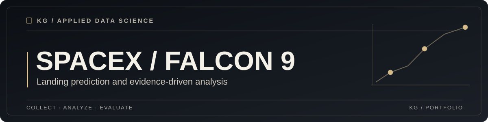

**An applied data science case study exploring whether Falcon 9 first stages can be predicted to land successfully.**

[Explore the notebooks](#explore-the-materials) · [Results](#results) · [Final presentation](Module5/README.md)

## Overview

This educational IBM Data Science capstone follows a workflow from launch data collection to exploratory analysis, interactive visualization and binary landing outcome prediction.

## What it includes

* SpaceX API collection and Wikipedia web scraping.
* Data wrangling, visual EDA and SQL queries.
* Folium launch site maps and a Plotly Dash dashboard.
* Classifier comparison using Logistic Regression, SVM, Decision Tree and KNN.
* A [Module 5 presentation guide](Module5/README.md) with evidence sources and submission checks.

## Explore the materials

| Module | Work |
| --- | --- |
| [01 / Collection](Module1/README.md) | API, web scraping, data cleaning and CSV files |
| [02 / SQL](Module2/README.md) | Exploratory SQL analysis |
| [03 / Visualization](Module3/README.md) | Maps, dashboard source and saved figures |
| [04 / Machine learning](Module4/README.md) | Prediction and model evaluation notebook |
| [05 / Presentation](Module5/README.md) | Coursera template deliverables and evidence index |

## Getting started

Clone the repository and open a notebook in a compatible Jupyter environment. Review the imports and source file paths in each module. A single verified dependency lockfile and fully automated workflow are not currently provided.

For the dashboard, review the source and accompanying CSV in [Module 3](Module3/README.md). Do not assume the saved outputs reflect today's SpaceX launch records.

## Repository structure

~~~text
IBM_Applied_Data_Science_Capstone/
├── Module1/             # Collection and wrangling
├── Module2/             # SQL analysis
├── Module3/             # Maps, Dash and visual evidence
├── Module4/             # Classifier training and evaluation
├── Module5/             # Final presentation guide
├── docs/assets/         # Shared cover
└── README.md
~~~

## Results

All four classifiers reported **83.3% test accuracy** on a small held-out sample of **18 observations** in the saved notebook. Cross-validation scores differed, with the highest saved mean associated with Decision Tree.

The dataset and splitting strategy limit interpretation. The notebook fit feature scaling before the training and test split, which introduces potential preprocessing leakage. A reproducible reevaluation should place preprocessing inside a cross-validation pipeline.

## Validation

There is not yet a common automated test suite for the full repository. Reproducing the results requires the original input datasets, compatible dependencies and careful notebook execution. Test accuracy is an educational result, not a production performance guarantee.

## Architecture & decisions

The modules preserve the order of the IBM course assignments and distinguish collection, SQL, visualization and modeling. The final presentation follows the original IBM and Coursera slide template.

## Security & limitations

Do not reuse external data or course media without checking their usage terms. Some visuals were reconstructed from saved CSV data rather than captured from live dashboard sessions. The final presentation binaries must be checked as present before using their GitHub download links.

## License

No standalone repository license was found. Third-party course materials and datasets may be subject to additional terms.
